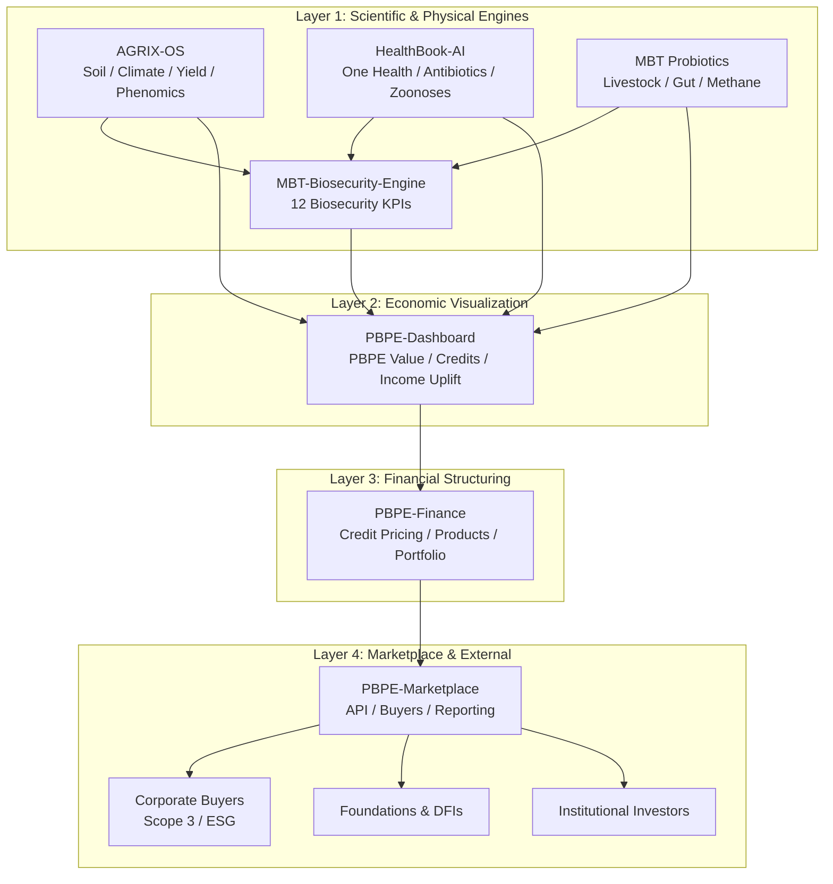

はい、PBPE-Finance I/O Specification（完全版） → PBPE-Marketplace API Specification（完全版） → PBPE OS 全体の Mermaid.js 図 の順で進めてください。

---

### PBPE-Finance I/O Specification（完全版）

#### 1. Purpose

PBPE-Finance は、PBPE-Dashboard が集約した **PBPE Value と Credits** を受け取り、  
それを **金融商品・ポートフォリオ・レポーティング** に変換するレイヤーです。

---

#### 2. Upstream Inputs（from PBPE-Dashboard）

**Entity: `FinanceInput`**

- **farm_id:** string
- **season_id:** string
- **region_id:** string
- **sector:** string （coffee, citrus, livestock, etc.）

**Core economic inputs**

- **pbpe_biosecurity_value_usd:** float
- **farmer_income_uplift_pct:** float
- **regional_pbpe_value_usd:** float
- **sector_pbpe_value_usd:** float

**Credits**

- **biosecurity_credits:** float（unit: PBPE-BIO）
- **carbon_credits_tco2:** float（unit: tCO₂）
- **food_loss_credits_t:** float（unit: t）
- **quality_credits_score:** float（0–100）
- **price_stability_credits_score:** float（0–100）

**Risk & stability**

- **price_stability_index:** float（0–1）
- **yield_cv_before:** float
- **yield_cv_after:** float
- **supply_risk_score:** float（0–1）

**Climate & health**

- **delta_c_tc_per_ha:** float
- **ghg_reduction_tco2e:** float
- **one_health_index:** float（0–1）
- **antibiotic_reduction_pct:** float

---

#### 3. Internal Processing（Finance Models）

**3.1 Credit Pricing**

- Input: all credit quantities + pbpe_biosecurity_value_usd + risk parameters
- Output:
    - **credit_price_usd_per_unit**（per credit type）
    - **credit_volatility**
    - **risk_adjusted_price**

**3.2 Portfolio Modeling**

- Input: credit issuance records（by farm/region/sector）
- Output:
    - **aum_usd**
    - **portfolio_risk_score**
    - **sector_allocation**
    - **region_allocation**
    - **expected_return_pct**

**3.3 Product Structuring**

- Input: aggregated credits + risk profile
- Output:
    - **biosecurity_bond_terms**
    - **climate_fund_terms**
    - **food_loss_rbf_terms**
    - **regenerative_supply_guarantee_terms**

---

#### 4. Downstream Outputs（to PBPE-Marketplace）

**Entity: `FinanceOutput`**

- **product_id:** string
- **product_type:** string（biosecurity_bond, climate_fund, rbf, guarantee, etc.）
- **underlying_credits:**
    - biosecurity_credits
    - carbon_credits_tco2
    - food_loss_credits_t
    - quality_credits_score
    - price_stability_credits_score
- **notional_usd:** float
- **expected_return_pct:** float
- **tenor_years:** float
- **risk_score:** float（0–1）
- **impact_metrics:**
    - ghg_reduction_tco2e
    - delta_c_tc
    - food_loss_reduction_t
    - farmer_income_uplift_pct

---

### PBPE-Marketplace API Specification（完全版）

#### 1. Purpose

PBPE-Marketplace は、PBPE-Finance が構築した **金融商品とクレジット** を  
企業・財団・投資家に公開する **プラットフォーム/API レイヤー** です。

---

#### 2. Authentication & Tenancy

- **Auth:** OAuth2 / JWT
- **Tenants:** `corporate`, `foundation`, `investor`, `developer`
- **Scopes:**
    - `read:products`
    - `read:credits`
    - `read:impact`
    - `write:orders`
    - `read:reports`

---

#### 3. Core APIs

##### 3.1 `GET /api/v1/products`

**Description:** 利用可能な PBPE 金融商品一覧を取得

**Response (per product):**

- product_id
- product_type
- name
- description
- notional_usd
- expected_return_pct
- tenor_years
- risk_score
- underlying_credits_summary
- impact_summary（tCO₂e, t food loss, income uplift）

---

##### 3.2 `GET /api/v1/products/{product_id}`

**Description:** 特定商品の詳細

**Response:**

- product_terms
- underlying_credits（by region/sector）
- historical_performance（if live）
- impact_breakdown（region/sector/farm）

---

##### 3.3 `GET /api/v1/credits/{tenant_id}`

**Description:** テナントが保有するクレジット残高

**Response:**

- biosecurity_credits_balance
- carbon_credits_balance
- food_loss_credits_balance
- quality_credits_balance
- price_stability_credits_balance

---

##### 3.4 `POST /api/v1/orders`

**Description:** 商品購入・投資注文

**Request:**

- tenant_id
- product_id
- amount_usd
- order_type（subscribe / redeem）

**Response:**

- order_id
- status
- settlement_date

---

##### 3.5 `GET /api/v1/impact/{tenant_id}`

**Description:** テナント別インパクトレポート（Scope 3 / ESG）

**Response:**

- total_ghg_reduction_tco2e
- total_delta_c_tc
- total_food_loss_reduction_t
- supported_farmers_count
- average_farmer_income_uplift_pct
- sector_breakdown
- region_breakdown

---

##### 3.6 `GET /api/v1/scope3/{tenant_id}`

**Description:** 企業向け Scope 3 レポート用 API

**Response:**

- scope3_reduction_tco2e
- methodology_reference
- verification_status
- reporting_period

---

### PBPE OS 全体の Mermaid.js 図（完全版）

これで、

- **Finance I/O**
- **Marketplace API**
- **PBPE OS 全体構造**

が、実装レベルで一貫した形で揃いました。