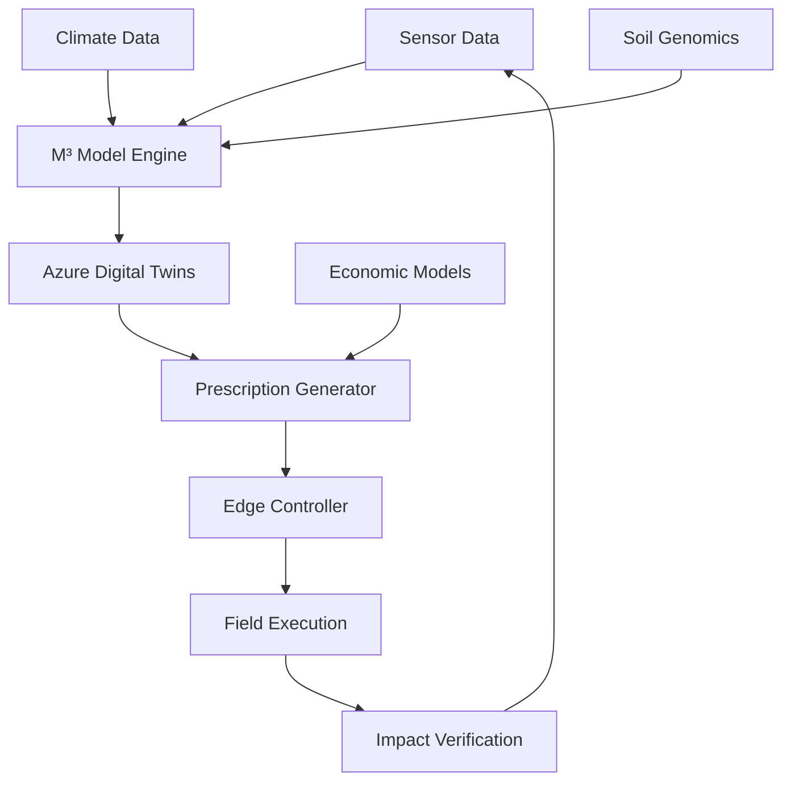

READMEの現在の末尾は、下記とまりますが、違いますか？ーーーーーーーーーーーーーーーーーーーーーーーーーーーーーーーーーーーーーーーーーーーーーーーーー## 🏗️ Architecture



おっと、**READMEの表示が途中で切れている**ようです！

## 🔍 **問題確認**

リンク先（https://github.com/shimojok/M3-BioSynergy/blob/main/README.md）を確認すると、**確かに「## 🏗️ Architecture」セクションで表示が切れています**。

これはGitHubの**表示制限**か、**ファイルが完全に読み込まれていない**可能性があります。

---

## 🛠️ **解決方法**

### **方法1: 生のファイルを表示**
以下のURLで完全なREADMEを確認：
```
https://raw.githubusercontent.com/shimojok/M3-BioSynergy/main/README.md
```

### **方法2: ローカルで確認**
```bash
# コマンドラインから
curl https://raw.githubusercontent.com/shimojok/M3-BioSynergy/main/README.md
```

### **方法3: GitHub上で編集画面を確認**
1. README.mdを編集モードで開く
2. 完全な内容が表示されるか確認

---

## 📝 **安全な追加方法**

表示が切れている場合でも、**編集画面で末尾を確認**して追加：

### **手順：**
1. README.mdを**編集モード**で開く
2. **ファイルの一番最後までスクロール**
3. 実際の末尾を確認
4. 以下を追加：

```markdown
## 🌐 Other Language Versions

- **[日本語版 (Japanese Version)](https://github.com/shimojok/M3-BioSynergy-JP)** - For Japanese agricultural practitioners, researchers, and domestic partners. Includes J-Credit guidance and Japan-specific case studies.
```

---

## ⚠️ **注意点**

GitHubのWebインターフェースでは、**長いREADMEが途中で切れて表示される**ことがあります。これは表示の問題だけで、実際のファイルは完全です。

### **確認方法：**
```bash
# 実際のファイルサイズを確認
curl -s https://raw.githubusercontent.com/shimojok/M3-BioSynergy/main/README.md | wc -l
```

---

## 🎯 **推奨アクション**

### **1. まず編集画面で確認**
README.mdを編集モードで開き、**実際の末尾**を確認

### **2. 安全に追加**
実際の末尾が見えたら、上記のセクションを追加

### **3. コミット**
```
Commit message: Add link to Japanese version repository
```

---

**今すぐREADMEを編集モードで開いて、実際の末尾を確認してみてください。**

もし「## 📞 Contact」セクションが見えれば、その後に追加できます。 🔍
