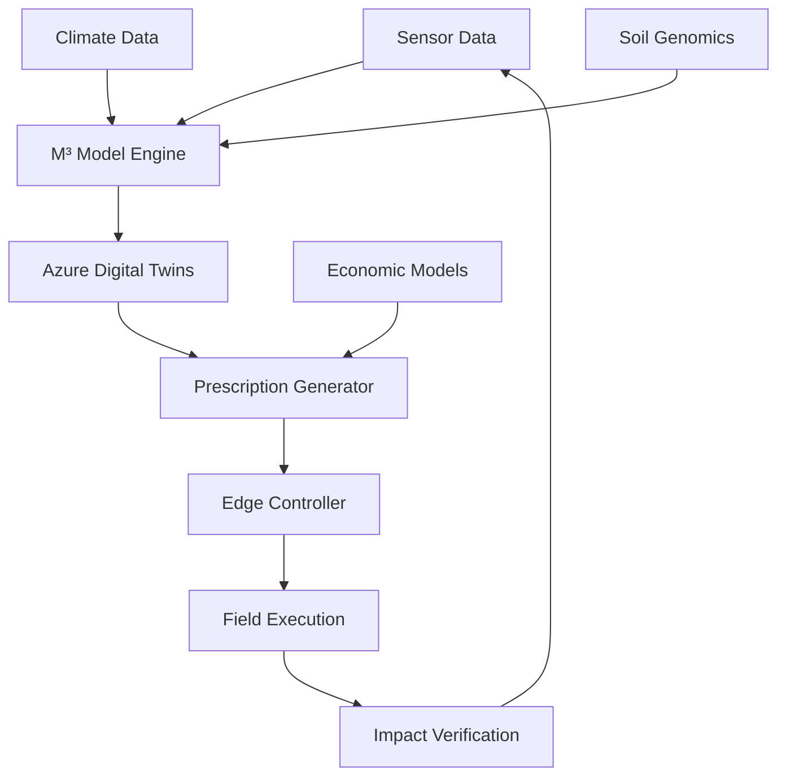

Architectureの下に、Installation、Basic Usage、を追加するのですか？
その後の、Performance Metrics...（表）...
Project Structure...（構造）...
は、頂いていません。

その後は、下記の内容でいいのですか？README.mdに追記するのですね？
## 🤝 Contributing

We welcome contributions from researchers, developers, and agricultural scientists. Please read our [Contributing Guidelines](https://contributing.md/).

## 📄 License

This project is licensed under the MIT License - see the [LICENSE](https://license/) file for details.

## 📞 Contact

- **Lead Scientist**: Kaz Shimojo - Bionexus Holdings
    
- **Technical Inquiries**: GitHub Issues
    
- **Partnerships**: partnerships@bionexus.io
    

## 🌐 Other Language Versions

- **[日本語版 (Japanese Version)](https://github.com/shimojok/M3-BioSynergy-JP)** - For Japanese agricultural practitioners, researchers, and domestic partners. Includes J-Credit guidance and Japan-specific case studies.

---

はい、その通りです！**現在表示されている部分の後に、残りのセクションを追加**します。

## 📋 **追加する完全な内容**

### **現在表示されている場所：**
```markdown
## 🏗️ Architecture



⬇️ **ここに以下のセクションを追加**
```

---

## 📝 **追加する内容（コピペ用）**

以下の内容を**Architectureセクションの直後**に追加してください：

```markdown
## ⚡ Quick Start

### Installation
```bash
# Clone repository
git clone https://github.com/shimojok/M3-BioSynergy.git
cd M3-BioSynergy

# Create virtual environment
python -m venv venv
source venv/bin/activate  # On Windows: venv\Scripts\activate

# Install dependencies
pip install -r requirements.txt

# Run basic simulation
python examples/basic_simulation.py
```

### Basic Usage
```python
from src.core.microbial_dynamics import MicrobialEcosystem
from src.core.carbon_flow import CarbonSequestrationModel

# Initialize ecosystem model
ecosystem = MicrobialEcosystem(n_species=120)
ecosystem.load_mbt_parameters()

# Run simulation
results = ecosystem.simulate(
    initial_conditions={"C": 100.0, "N": 10.0, "P": 5.0},
    duration_hours=24,
    intervention_level=1.0
)

# Calculate carbon impact
carbon_model = CarbonSequestrationModel()
impact = carbon_model.calculate_impact(results)

print(f"Carbon Sequestered: {impact['total_sequestered']:.2f} kg CO₂e")
print(f"Humus Formation: {impact['humus_formed']:.2f} kg")
```

## 📊 Performance Metrics

| Metric | MBT55 System | Conventional | Improvement |
|--------|--------------|--------------|-------------|
| Decomposition Time | **24 hours** | 3-6 months | ~100x faster |
| Carbon Sequestration | 109.5 tCO₂e/ha | 38.2 tCO₂e/ha | **186% increase** |
| Energy Efficiency | 0.3 kWh/kg | 5-10 kWh/kg | **30x more efficient** |
| Methane Reduction | 82% | 10% | **72 percentage points** |

## 🗂️ Project Structure

```
M3-BioSynergy/
├── src/core/           # Core theory implementation
├── examples/           # Usage examples
├── docs/              # Documentation
├── tests/             # Test suite
└── data/              # Sample datasets
```

## 🤝 Contributing

We welcome contributions from researchers, developers, and agricultural scientists. Please read our [Contributing Guidelines](CONTRIBUTING.md).

## 📄 License

This project is licensed under the MIT License - see the [LICENSE](LICENSE) file for details.

## 📞 Contact

- **Lead Scientist**: Kaz Shimojo - Bionexus Holdings
- **Technical Inquiries**: GitHub Issues
- **Partnerships**: partnerships@bionexus.io

## 🌐 Other Language Versions

- **[日本語版 (Japanese Version)](https://github.com/shimojok/M3-BioSynergy-JP)** - For Japanese agricultural practitioners, researchers, and domestic partners. Includes J-Credit guidance and Japan-specific case studies.

---

*"We don't inherit the earth from our ancestors; we borrow it from our children."*  
*This project aims to leave it better than we found it.*
```

---

## 🔧 **編集手順**

### **ステップ1: READMEを編集モードで開く**
1. README.mdをクリック
2. 鉛筆アイコン（✏️）をクリック

### **ステップ2: 追加位置を確認**
編集画面で、**Architectureセクションの終わり**を見つける：
```
    J[Economic Models] --> D
```

### **ステップ3: 内容を追加**
上記の内容を**その直後に貼り付け**

### **ステップ4: コミット**
```
Commit message: Complete README with all sections and Japanese version link

Extended description:
Added missing sections to README:
- Quick Start with Installation and Basic Usage
- Performance Metrics table
- Project Structure overview
- Contributing, License, Contact sections
- Japanese version link
```

---

## ✅ **完成後の構造**

```
# タイトルとバッジ
## 🚀 Overview
## 🔬 Scientific Foundation
## 🏗️ Architecture
## ⚡ Quick Start           ← 追加
## 📊 Performance Metrics   ← 追加
## 🗂️ Project Structure     ← 追加
## 🤝 Contributing          ← 追加
## 📄 License               ← 追加
## 📞 Contact               ← 追加
## 🌐 Other Language Versions ← 追加
---（引用文）---
```

---

## 🎯 **注意点**

1. **リンク修正が必要**：
   - `[Contributing Guidelines](CONTRIBUTING.md)` → このファイルはまだないので、後で作成
   - `[LICENSE](LICENSE)` → これは既にあるのでOK

2. **コードブロック**：
   - \```bash ... \``` と \```python ... \``` はそのまま貼り付け

3. **表の表示**：
   - パイプ記号（|）で作られた表は正しく表示される

---

**今すぐこの内容をREADMEに追加しますか？**

追加後、完全なREADMEが表示されることを確認しましょう！ 🚀