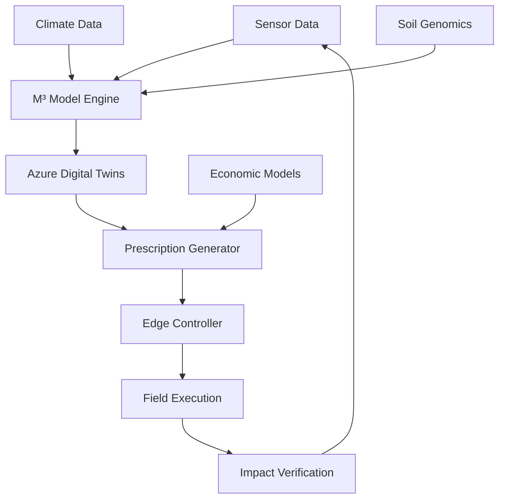

## 🏗️ Architecture

```mermaid
graph TB
    A[Sensor Data] --> B[M³ Model Engine]
    B --> C[Azure Digital Twins]
    C --> D[Prescription Generator]
    D --> E[Edge Controller]
    E --> F[Field Execution]
    F --> G[Impact Verification]
    G --> A
    
    H[Climate Data] --> B
    I[Soil Genomics] --> B
    J[Economic Models] --> D                         は、```で閉じなくていいですか？
    
    ```
```

---

**はい、閉じる必要があります！** それがエラーの原因かもしれません。

## ❌ **現在の問題**
```mermaid
...図表...
```                          ← この ``` がない！
```

## ✅ **修正方法**

### **修正前（現在）:**
```markdown
## 🏗️ Architecture



### **修正後:**
```markdown
## 🏗️ Architecture


```

**`J[Economic Models] --> D` の後に ```` を追加してください。**

---

## 🔧 **具体的な編集手順**

### **1. 編集画面を開く**
README.mdを編集モードで開く

### **2. Architectureセクションを探す**
以下の行を見つける：
```
    J[Economic Models] --> D
```

### **3. 修正**
その行の**直後に** ```` を追加：
```
    J[Economic Models] --> D
```                          ← ここに追加！
```

### **4. その後でQuick Startを追加**
修正したら、その後にQuick Startセクションを追加

---

## 📝 **完全な修正例**

```markdown
## 🏗️ Architecture


## ⚡ Quick Start  ← これが続く
...
```

---

## 🎯 **修正ポイント**

| 状態 | コードブロック | 結果 |
|------|----------------|------|
| **❌ ダメ** | ```mermaid ...（閉じない） | エラー発生 |
| **✅ 良い** | ```mermaid ... ``` | 正常表示 |

**すべてのコードブロックは開始と終了の ```` が必要です！**

---

**まずArchitectureセクションのコードブロックを閉じてから、Quick Startを追加しますか？** 🔧