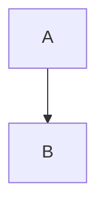

```bashも、```で閉じるのですか？

**はい、その通りです！** すべてのコードブロックは ```` で閉じる必要があります。

## 📚 **すべてのコードブロックのルール**

### **1. 基本的な構造**
```
```言語名
コード内容
```                          ← 必ず閉じる！
```

### **2. 具体例**

#### **Mermaid図表:**
````markdown

````

#### **Bashコード:**
````markdown
```bash
git clone ...
```
````

#### **Pythonコード:**
````markdown
```python
print("Hello")
```
````

---

## 🔧 **現在のREADMEにあるコードブロック**

### **修正が必要な場所:**
1. **Architectureセクション**（Mermaid）→ ``` で閉じる
2. **Installationセクション**（Bash）→ ``` で閉じる  
3. **Basic Usageセクション**（Python）→ ``` で閉じる

---

## 📝 **完全な修正例**

### **修正前（ダメ）:**
```markdown
## 🏗️ Architecture

```mermaid
...図表...
                          ← 閉じていない！

## ⚡ Quick Start

### Installation
```bash
...コード...
                          ← 閉じていない！

### Basic Usage
```python
...コード...
                          ← 閉じていない！
```

### **修正後（良い）:**
```markdown
## 🏗️ Architecture

```mermaid
...図表...
```

## ⚡ Quick Start

### Installation
```bash
...コード...
```

### Basic Usage
```python
...コード...
```
```

---

## 🎯 **今すぐ確認すべきこと**

### **編集画面で以下を確認:**
1. **Architectureセクション**: `J[Economic Models] --> D` の後に ```` があるか？
2. **Installationセクション**: `python examples/basic_simulation.py` の後に ```` があるか？
3. **Basic Usageセクション**: `print(f"Humus Formation...` の後に ```` があるか？

---

## 💡 **簡単な修正方法**

もし複雑なら、**いったんすべて削除して、正しい構造で新規作成**するのが早いかもしれません。

### **簡易版READMEから始める:**
```markdown
# M³-BioSynergy

## Quick Start
```bash
git clone ...
```

## Contact
- Kaz Shimojo
```

まずこれでコミット成功を確認してから、徐々に追加。

---

**現在のREADMEをすべて表示して、コードブロックが正しく閉じられているか確認しますか？**

それとも、**簡易版から作り直しますか？** 🔧