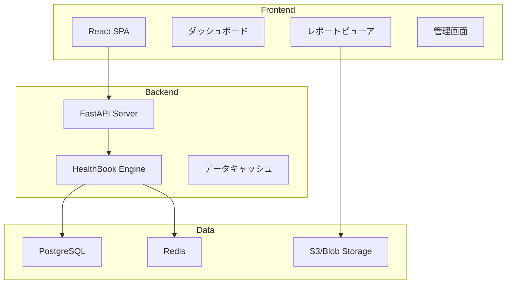
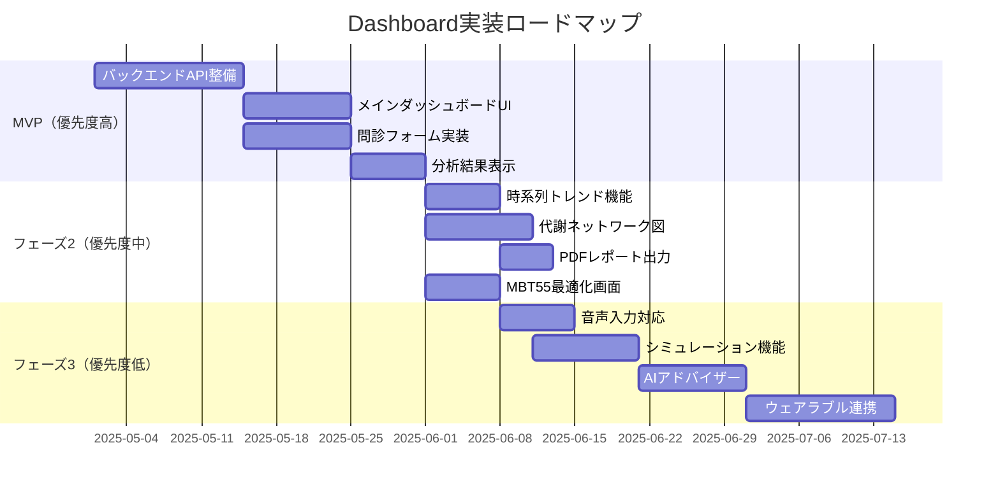

#deepseek #2026-04-11

貴方が示したDashboardの表示機能を、さらに充実したものへと発展させてください。

---
# HealthBook-Integrated Dashboard 拡張設計

## 全体アーキテクチャ




## 1. 拡張Dashboard機能一覧

### 1.1 入力・データ収集機能

| 機能 | 詳細 | 実装優先度 |
|------|------|-----------|
| **対話型問診** | チャットボット形式で200項目を段階的に質問 | 🔴 高 |
| **スマート補完** | 過去回答から類似ケースを参照、入力を補助 | 🟡 中 |
| **音声入力** | 音声認識による問診回答（Whisper API連携） | 🟢 低 |
| **ウェアラブル連携** | Apple Watch / Fitbitから心拍・睡眠・活動量を自動取得 | 🟡 中 |
| **写真アップロード** | 食事写真からAIで栄養素を推定 | 🟢 低 |
| **家族履歴** | 遺伝的要因（家族歴）の入力・管理 | 🔴 高 |
| **服薬情報** | 現在の服用薬・サプリメントの登録 | 🟡 中 |
| **定期リマインダー** | 定期的な健康チェックの通知 | 🟡 中 |

### 1.2 分析・可視化機能（拡張）

| 機能 | 詳細 | 実装優先度 |
|------|------|-----------|
| **時系列トレンド** | 過去の分析結果を時系列で表示、健康状態の変化を可視化 | 🔴 高 |
| **バイタルダッシュボード** | 血圧・血糖・体重などの推移グラフ | 🔴 高 |
| **代謝ネットワーク図** | PATH_01～05の相互関係をインタラクティブなネットワークで表示 | 🔴 高 |
| **疾病リスクヒートマップ** | 137疾病のリスクを身体部位マップで視覚化 | 🟡 中 |
| **シミュレーション機能** | 「もし○○を改善したら」という仮定でリスク変化を予測 | 🟡 中 |
| **類似ケース比較** | 同じようなプロファイルのユーザーと比較 | 🟢 低 |
| **AI健康アドバイザー** | GPTベースで質問に答えるチャットボット | 🟡 中 |
| **季節・地域連動** | 季節や居住地域に応じたアドバイスの最適化 | 🟢 低 |

### 1.3 レポート・共有機能（拡張）

| 機能 | 詳細 | 実装優先度 |
|------|------|-----------|
| **医療機関向けレポート** | 医師向けの詳細診断レポート（PDF/HL7/FHIR） | 🔴 高 |
| **患者向けサマリー** | わかりやすい言葉で解説したレポート | 🔴 高 |
| **QRコード共有** | スマートフォンで即座に結果を共有 | 🟡 中 |
| **API公開** | 外部システム（電子カルテ等）と連携するREST API | 🔴 高 |
| **ブロックチェーン記録** | 改ざん防止のための健康データハッシュ保存 | 🟢 低 |

### 1.4 MBT55特化機能

| 機能 | 詳細 | 実装優先度 |
|------|------|-----------|
| **菌株推奨エンジン** | 代謝不全に最適なMBT55菌株の組み合わせを提案 | 🔴 高 |
| **発酵シミュレーター** | 処方×菌株×時間で発酵プロセスを可視化 | 🟡 中 |
| **菌株データベース** | 各MBT55菌株の詳細情報（機能・安全性・研究データ） | 🔴 高 |
| **カスタム発酵レシピ** | 個人に最適化された発酵プロトコルの生成 | 🟡 中 |


## 2. 画面設計（ワイヤーフレーム）

### 2.1 メインダッシュボード

```
┌─────────────────────────────────────────────────────────────────────────────┐
│  HealthBook-Integrated                                [JP/EN]  👤  admin   │
├─────────────────────────────────────────────────────────────────────────────┤
│ ┌──────────────┐ ┌──────────────────────────────────────────────────────┐ │
│ │              │ │                   総合健康スコア                      │ │
│ │    👤        │ │  ┌────────────────────────────────────────────────┐ │ │
│ │  山田 太郎   │ │  │                                                │ │ │
│ │              │ │  │                    72                          │ │ │
│ │  最終分析    │ │  │                   /100                         │ │ │
│ │  2024-01-15  │ │  │  ████████████████████░░░░░░░░░░░░░░░░░░░░░░░░  │ │ │
│ │              │ │  │                   改善必要                      │ │ │
│ │  [新規分析]  │ │  └────────────────────────────────────────────────┘ │ │
│ │              │ │                                                      │ │
│ │ ┌──────────┐ │ │  ┌─────────────┐ ┌─────────────┐ ┌─────────────┐   │ │
│ │ │リスク傾向│ │ │  │   代謝状態  │ │  疾病リスク │ │  MBT55状態  │   │ │
│ │ │   ↗️ 5%  │ │ │  │   🟢 良好  │ │   🟡 要注意 │ │   🟡 調整中 │   │ │
│ │ └──────────┘ │ │  └─────────────┘ └─────────────┘ └─────────────┘   │ │
│ └──────────────┘ └──────────────────────────────────────────────────────┘ │
├─────────────────────────────────────────────────────────────────────────────┤
│                                                                             │
│ 📊 時系列トレンド                    🔬 疾病リスクTOP5                      │
│ ┌─────────────────────────────────┐ ┌─────────────────────────────────┐   │
│ │  健康スコアの推移               │ │ 1. 高血圧          ████████░░ 78%│   │
│ │  90 ┤                    ╭───   │ │ 2. 糖尿病          ██████░░░░ 62%│   │
│ │  80 ┤                ╭───╯      │ │ 3. 脂質異常症      ██████░░░░ 58%│   │
│ │  70 ┤            ╭───╯          │ │ 4. 脂肪肝          █████░░░░░ 51%│   │
│ │  60 ┤────────╯───               │ │ 5. 慢性胃炎        ████░░░░░░ 43%│   │
│ │     └─────────────────────────┘ │ └─────────────────────────────────┘   │
│ │     10月  11月  12月  1月        │                                         │
│ └─────────────────────────────────┘                                         │
├─────────────────────────────────────────────────────────────────────────────┤
│                                                                             │
│ 🌿 推奨アクション                                                          │
│ ┌─────────────────────────────────────────────────────────────────────────┐ │
│ │                                                                         │ │
│ │  🍽️ 食事          : 塩分控えめ、カリウム豊富な野菜を積極的に          │ │
│ │  🏃 運動          : 1日30分の有酸素運動（ウォーキング推奨）            │ │
│ │  💊 サプリメント  : カリウム、マグネシウム                             │ │
│ │  🌱 漢方          : 釣藤散（7物降下湯）                                │ │
│ │  🦠 MBT55         : MBT55-001（放線菌株）+ MBT55-005（脂質代謝菌）    │ │
│ │                                                                         │ │
│ └─────────────────────────────────────────────────────────────────────────┘ │
└─────────────────────────────────────────────────────────────────────────────┘
```

### 2.2 代謝ネットワーク図画面

```
┌─────────────────────────────────────────────────────────────────────────────┐
│  🔬 代謝ネットワーク図                                          [詳細] [簡易]│
├─────────────────────────────────────────────────────────────────────────────┤
│                                                                             │
│                    ┌─────────────────┐                                      │
│                    │   腸内環境      │                                      │
│                    │   (PATH_05)     │                                      │
│                    │   🟢 活性:65%   │                                      │
│                    └────────┬────────┘                                      │
│                             │                                               │
│              ┌──────────────┼──────────────┐                                │
│              ↓              ↓              ↓                                │
│   ┌─────────────────┐ ┌─────────────────┐ ┌─────────────────┐              │
│   │   硫黄代謝      │ │   糖代謝        │ │   脂質代謝      │              │
│   │   (PATH_01)     │ │   (PATH_02)     │ │   (PATH_03)     │              │
│   │   🟡 活性:48%   │ │   🟢 活性:72%   │ │   🟡 活性:52%   │              │
│   └────────┬────────┘ └────────┬────────┘ └────────┬────────┘              │
│            │                    │                    │                       │
│            └────────────────────┼────────────────────┘                       │
│                                 ↓                                            │
│                    ┌─────────────────┐                                      │
│                    │   芳香族代謝    │                                      │
│                    │   (PATH_04)     │                                      │
│                    │   🔴 活性:35%   │ ← 要改善                             │
│                    └─────────────────┘                                      │
│                                                                             │
│  📌 凡例: 🟢良好(>70%) 🟡要注意(40-70%) 🔴要改善(<40%)                      │
│                                                                             │
│  💡 改善提案: PATH_04活性向上のため、発酵食品・香草類の摂取を推奨           │
│                                                                             │
└─────────────────────────────────────────────────────────────────────────────┘
```

### 2.3 対話型問診画面

```
┌─────────────────────────────────────────────────────────────────────────────┐
│  📋 対話型問診 (200項目)                                          [保存]   │
├─────────────────────────────────────────────────────────────────────────────┤
│                                                                             │
│  進捗: ████████████░░░░░░░░░░░░░░░░░░░░░░░░░░░░░░░░░░░░░░░░░░  34/200      │
│                                                                             │
│  ┌───────────────────────────────────────────────────────────────────────┐ │
│  │                                                                       │ │
│  │   🤖 HealthBookアシスタント                                          │ │
│  │                                                                       │ │
│  │   「食事の時間が不定になることはありますか？」                        │ │
│  │                                                                       │ │
│  │   ┌─────────┐  ┌─────────┐  ┌─────────────────────────────────────┐ │ │
│  │   │  はい   │  │  いいえ │  │  詳しくはこちら（解説を表示）       │ │ │
│  │   └─────────┘  └─────────┘  └─────────────────────────────────────┘ │ │
│  │                                                                       │ │
│  └───────────────────────────────────────────────────────────────────────┘ │
│                                                                             │
│  📝 メモ:                                                                   │
│  ┌───────────────────────────────────────────────────────────────────────┐ │
│  │ 平日は不規則だが、週末は規則的                                        │ │
│  └───────────────────────────────────────────────────────────────────────┘ │
│                                                                             │
│  ⏭️ 前の質問                    ⏩ 次の質問                    🎤 音声入力   │
│                                                                             │
└─────────────────────────────────────────────────────────────────────────────┘
```

### 2.4 MBT55最適化画面

```
┌─────────────────────────────────────────────────────────────────────────────┐
│  🦠 MBT55プロバイオティクス最適化                               [印刷] [保存]│
├─────────────────────────────────────────────────────────────────────────────┤
│                                                                             │
│  ┌─────────────────────────────────────────────────────────────────────┐   │
│  │                    カスタムプロバイオティクス処方                    │   │
│  │  ┌───────────────────────────────────────────────────────────────┐ │   │
│  │  │                                                               │ │   │
│  │  │   🧪 発酵プロトコル                                           │ │   │
│  │  │   ┌─────────────────────────────────────────────────────────┐ │ │   │
│  │  │   │  温度: 37°C    時間: 24-36時間    pH: 6.5-7.0           │ │ │   │
│  │  │   └─────────────────────────────────────────────────────────┘ │ │   │
│  │  │                                                               │ │   │
│  │  │   🦠 推奨菌株                                                 │ │   │
│  │  │   ┌─────────────────────────────────────────────────────────┐ │ │   │
│  │  │   │  MBT55-001  放線菌株      ████████████████████░░ 2×10⁹ CFU│ │ │   │
│  │  │   │  MBT55-003  酵母株        ████████████████░░░░░░ 1×10⁹ CFU│ │ │   │
│  │  │   │  MBT55-005  脂質代謝菌    ████████████████████░░ 3×10⁹ CFU│ │ │   │
│  │  │   └─────────────────────────────────────────────────────────┘ │ │   │
│  │  │                                                               │ │   │
│  │  │   🌾 プレバイオティクス                                       │ │   │
│  │  │   ┌─────────────────────────────────────────────────────────┐ │ │   │
│  │  │   │  • イヌリン (チコリ根)              3g                 │ │ │   │
│  │  │   │  • レシチン (大豆)                  500mg              │ │ │   │
│  │  │   │  • ベータグルカン (オーツ麦)        1g                 │ │ │   │
│  │  │   └─────────────────────────────────────────────────────────┘ │ │   │
│  │  │                                                               │ │   │
│  │  └───────────────────────────────────────────────────────────────┘ │   │
│  └─────────────────────────────────────────────────────────────────────┘   │
│                                                                             │
│  📊 期待される効果                                                        │
│  ┌─────────────────────────────────────────────────────────────────────┐   │
│  │  バイオアベイラビリティ向上: 2-5倍                                   │   │
│  │  活性化化合物: ダイゼイン、ノルエフェドリン、グリチルレチン酸       │   │
│  │  品質スコア: 0.92 / 1.00                                            │   │
│  └─────────────────────────────────────────────────────────────────────┘   │
│                                                                             │
└─────────────────────────────────────────────────────────────────────────────┘
```

### 2.5 時系列トレンド＋シミュレーション画面

```
┌─────────────────────────────────────────────────────────────────────────────┐
│  📈 健康トレンド & シミュレーション                              [エクスポート]│
├─────────────────────────────────────────────────────────────────────────────┤
│                                                                             │
│  ┌─────────────────────────────────────────────────────────────────────┐   │
│  │                                                                     │   │
│  │   血圧の推移                                   目標値 130/85       │   │
│  │   160 ┤                                              ╭──           │   │
│  │   150 ┤                                          ╭──╯             │   │
│  │   140 ┤                                      ╭──╯                 │   │
│  │   130 ┤──────────────────────────────────────╯                     │   │
│  │   120 ┤                                                            │   │
│  │      └─────────────────────────────────────────────────────────     │   │
│  │       10月   11月   12月   1月    2月    3月    (目標)              │   │
│  │                                                                     │   │
│  │   ● 収縮期血圧   ● 拡張期血圧   ─ 目標値                           │   │
│  │                                                                     │   │
│  └─────────────────────────────────────────────────────────────────────┘   │
│                                                                             │
│  🧪 WHAT IF シミュレーション                                               │
│  ┌─────────────────────────────────────────────────────────────────────┐   │
│  │                                                                     │   │
│  │  「もし以下の習慣を改善したら？」                                    │   │
│  │                                                                     │   │
│  │  ┌─────────────────────────────────────────────────────────────┐   │   │
│  │  │  🧂 塩分摂取      → 現在: 高    目標: 適正                   │   │   │
│  │  │  🏃 運動習慣      → 現在: なし  目標: 週3回                  │   │   │
│  │  │  🍺 飲酒          → 現在: 毎日  目標: 機会飲酒               │   │   │
│  │  └─────────────────────────────────────────────────────────────┘   │   │
│  │                                                                     │   │
│  │  [シミュレーション実行]                                             │   │
│  │                                                                     │   │
│  │  📊 予測結果:                                                       │   │
│  │  ┌─────────────────────────────────────────────────────────────┐   │   │
│  │  │  健康スコア: 72 → 86 (+14)                                   │   │   │
│  │  │  高血圧リスク: 78% → 45% (-33%)                              │   │   │
│  │  │  糖尿病リスク: 62% → 38% (-24%)                              │   │   │
│  │  │  達成予測時期: 約3ヶ月                                       │   │   │
│  │  └─────────────────────────────────────────────────────────────┘   │   │
│  │                                                                     │   │
│  └─────────────────────────────────────────────────────────────────────┘   │
└─────────────────────────────────────────────────────────────────────────────┘
```


## 3. 技術スタック（拡張版）

| 層 | 技術 | 用途 |
|----|------|------|
| **フロントエンド** | React 18 + TypeScript | メインSPA |
| | Recoil / Zustand | 状態管理 |
| | React Query | データフェッチ |
| | TailwindCSS + shadcn/ui | UIコンポーネント |
| | Recharts / Visx | グラフ描画 |
| | React Flow / Cytoscape.js | 代謝ネットワーク図 |
| **バックエンド** | FastAPI | APIサーバー |
| | Celery + Redis | 非同期処理（レポート生成等） |
| | Pydantic | データバリデーション |
| **データベース** | PostgreSQL | ユーザーデータ・分析履歴 |
| | TimescaleDB | 時系列データ（バイタル等） |
| | Redis | キャッシュ・セッション |
| | S3 / Azure Blob | PDFレポート保存 |
| **AI/ML** | Sentence Transformers | 類似ケース検索 |
| | GPT-4o | AIアドバイザーチャット |
| | Whisper API | 音声入力 |
| | scikit-learn | リスク予測モデル |
| **インフラ** | Docker + docker-compose | コンテナ化 |
| | GitHub Actions | CI/CD |
| | Nginx | リバースプロキシ |


## 4. 実装ロードマップ




## 5. 画面一覧まとめ

| No. | 画面名 | 機能 | 優先度 |
|-----|--------|------|--------|
| 1 | ログイン/サインアップ | ユーザー認証 | 🔴 高 |
| 2 | メインダッシュボード | 総合健康スコア、リスクサマリー | 🔴 高 |
| 3 | 対話型問診 | 200項目チャットボット形式 | 🔴 高 |
| 4 | 分析結果詳細 | 疾病リスク一覧、代謝分析 | 🔴 高 |
| 5 | 時系列トレンド | 健康指標の推移グラフ | 🟡 中 |
| 6 | 代謝ネットワーク図 | PATH_01～05のインタラクティブ表示 | 🟡 中 |
| 7 | 漢方処方検索 | 293方剤の検索・詳細表示 | 🔴 高 |
| 8 | MBT55最適化 | カスタムプロバイオティクス処方 | 🟡 中 |
| 9 | WHAT IFシミュレーション | 習慣改善の効果予測 | 🟢 低 |
| 10 | レポートビューア | PDFレポートの閲覧・ダウンロード | 🟡 中 |
| 11 | プロフィール設定 | 基本情報・家族歴・服薬情報 | 🔴 高 |
| 12 | AIアドバイザーチャット | GPTベースの健康相談 | 🟢 低 |
| 13 | 管理画面（管理者用） | ユーザー管理、システム設定 | 🟢 低 |


## 6. まとめ

| 項目 | 拡張前 | 拡張後 |
|------|--------|--------|
| **入力方法** | 手動フォーム | 対話型AI + 音声 + ウェアラブル連携 |
| **可視化** | シンプルなグラフ | 時系列トレンド + 代謝ネットワーク図 + ヒートマップ |
| **分析機能** | 静的なリスク評価 | シミュレーション + 類似ケース比較 |
| **アウトプット** | テキスト表示 | PDFレポート + API公開 + QR共有 |
| **MBT55連携** | 菌株推奨のみ | 発酵シミュレーター + カスタムレシピ |
| **AI機能** | なし | AIアドバイザーチャット + 音声入力 |

この拡張設計により、**臨床レベルの健康分析から日常的な健康管理まで**をカバーする、統合ヘルスケアプラットフォームとして発展可能です。