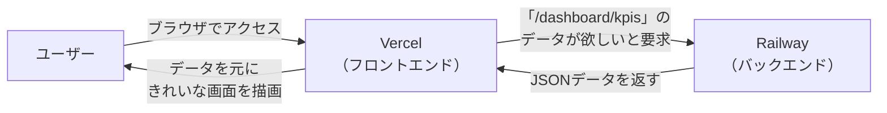

  pbpe-marketplace.vercel.app/dashboard/kpis 
[pbpe-marketplace-production.up](http://pbpe-marketplace-production.up/).railway.app/dashboard/kpis 
上記の vercel/frontend, railway/backend のURLが同じページを表示する構造を教えてください。

---

Kazさん、この疑問は非常に重要です。**URLが異なるのに同じようなページが表示される理由**を、明確に説明します。

## 🧭 結論：役割が完全に異なります

表示されている内容が一見同じに見えても、**両者は「役割」と「表示の仕組み」が根本的に異なります。**

---

### 1. VercelのURL（フロントエンド）
```
https://pbpe-marketplace.vercel.app/dashboard/kpis
```

- **役割**: **ユーザーが直接見る「画面（UI）」** を提供する場所です。
- **表示の仕組み**: Next.jsで構築された**フロントエンドのアプリケーション**が動いています。HTML、CSS、JavaScriptをブラウザに送り、**ブラウザ上で画面を描画**します。
- **データの取得先**: 内部でAPIリクエストを送り、データを取得して画面に表示します。そのデータの取得先が、**バックエンド（Railway）** です。

---

### 2. RailwayのURL（バックエンド）
```
https://pbpe-marketplace-production.up.railway.app/dashboard/kpis
```

- **役割**: **データ（JSON）を提供する「APIサーバー」** です。画面（UI）は一切持ちません。
- **表示の仕組み**: FastAPIというフレームワークで構築されており、リクエストされたパス（`/dashboard/kpis`）に対して、**JSON形式のデータ**を返すようにプログラムされています。
- **なぜ開けるのか**: ブラウザでこのURLを開くと、FastAPIが「このパスにアクセスがあったら、このJSONデータを返す」という指示に従って、**JSONデータをそのまま表示**します。ブラウザがJSONを人間にも読める形で表示しているだけで、Vercelのような「きれいな画面」は存在しません。

---

## 📊 両者の関係（データフロー）



---

## 🔑 まとめ

| 項目 | Vercel（フロントエンド） | Railway（バックエンド） |
|---|---|---|
| **役割** | ユーザーに見せる「画面」 | データを提供する「API」 |
| **データ** | データを表示する | データをJSONで返す |
| **URLの意味** | 画面のページを示す | APIのエンドポイントを示す |
| **同じURLで表示される内容** | ダッシュボード画面（HTML） | JSON形式のデータ |

---

### ✅ あなたのプロジェクトで考えると

- **Vercelの `.../dashboard/kpis`** は、ユーザーが**見るためのダッシュボード画面**です。
- **Railwayの `.../dashboard/kpis`** は、Vercelが**データを取得するためのAPIエンドポイント**です。

つまり、**「同じパスに見えるけど、役割がまったく違う」** というのが正しい理解です。